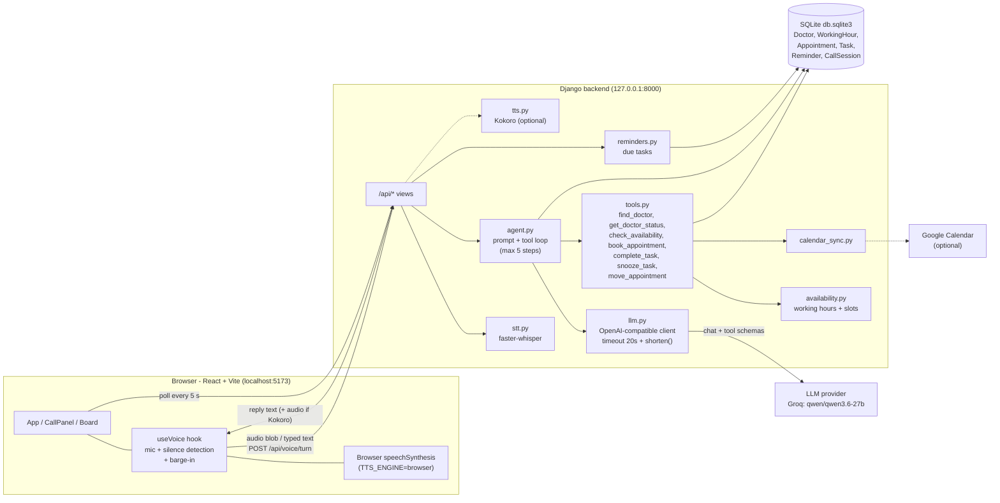

# Voice Scheduling Agent

An AI voice front desk for a clinic. Patients talk to it to find a doctor, check where a doctor is, and book an appointment. Doctors talk to it to hear their to-dos and reminders, mark tasks done, snooze them, or move a meeting.

Built with **Django + React (Vite)**. Speech-to-text runs locally (Whisper), the "brain" is any OpenAI-compatible LLM (Groq by default), and speech output uses the browser's built-in voice (or optional Kokoro TTS).

---

## Features

**Patient mode**
- Ask "where is Dr. Khan?": room, floor, and whether she is free right now
- Check availability and book a 30-minute appointment
- The agent always reads back doctor, date, time, time zone and purpose, and books only after the caller says yes
- The agent says it is an AI, and keeps replies short

**Doctor mode**
- Incoming reminder call ("Answer" button) for due to-dos
- Reminders repeat until the task is marked done or snoozed
- Mark done, snooze, or move an appointment by voice

**Staff board (right side of the screen)**
- Live doctor presence (in room / away), appointments, and to-dos with reminder counts
- Refreshes every 5 seconds

**Voice loop**
- Silence detection ends your turn automatically; speaking over the agent interrupts it (barge-in)
- You can also type a message at any time during a call

---

## Architecture



### What happens in one turn

1. The browser records your voice until about 1 second of silence (or you type a message).
2. `POST /api/voice/turn` sends the audio or text with the `session_id`.
3. Audio goes through **faster-whisper** to become text. Typed text skips this step.
4. `agent.run_turn` adds the text to the session and calls the **LLM** with the system prompt and the tool list for the role (patient or doctor).
5. If the LLM asks for a tool, `tools.run` executes it against the database (and Google Calendar if configured), and the result goes back to the LLM. This repeats up to 5 times.
6. The final reply is cleaned by `shorten()` (no rambling, no duplicates) and returned.
7. The browser speaks it with the browser voice and then listens again.

---

## Project structure

```
.env                          settings (model, API key, clinic name, timezone)
backend/
  manage.py
  requirements.txt            main dependencies (av pinned to 16.1.0)
  requirements-tts.txt        optional Kokoro voice (Python 3.10-3.12 only)
  requirements-bench.txt      optional STT/TTS benchmark tools
  config/                     Django settings and URLs
  frontdesk/
    models.py                 Doctor, WorkingHour, Appointment, Task, Reminder, CallSession
    views.py, urls.py         REST API
    agent.py                  system prompts, greeting, LLM <-> tool loop
    llm.py                    LLM client (20 s timeout) + reply cleanup
    tools.py                  the 7 agent tools and their JSON schemas
    availability.py           working hours, free slots, time zone handling
    reminders.py              which tasks are due right now
    calendar_sync.py          Google Calendar (falls back to "local only")
    stt.py / tts.py           Whisper speech-to-text / optional Kokoro TTS
    tests.py                  11 backend tests (LLM is mocked)
    management/commands/seed_demo.py   demo doctors and hours
  tools/stt_bench.py, tts_bench.py
frontend/
  vite.config.js              proxies /api to localhost:8000
  src/App.jsx                 layout, role switch, reminder polling
  src/CallPanel.jsx           call controls, captions, typed input
  src/useVoice.js             mic loop, silence detection, barge-in, speech output
  src/Board.jsx               doctors, appointments, to-dos
  src/api.js                  fetch helpers
```

---

## Setup (Windows / PowerShell)

Requires **Python 3.10+** and **Node.js 18+**, plus a free [Groq](https://console.groq.com) API key.

```powershell
# 1. Virtual environment (from the project root)
python -m venv .venv
Set-ExecutionPolicy -Scope Process -ExecutionPolicy RemoteSigned
.\.venv\Scripts\Activate.ps1

# 2. Backend
cd backend
pip install -r requirements.txt
python manage.py migrate
python manage.py seed_demo            # add --open-all-day to test at any hour
python manage.py runserver

# 3. Frontend (second terminal)
cd frontend
npm install
npm run dev
```

Open the address Vite prints (normally **http://localhost:5173**), not port 8000.

> The first spoken turn downloads the Whisper `small` model (about 460 MB). The app looks frozen for a while; watch the Django terminal for progress. This happens once.

---

## Configuration (`.env` in the project root)

| Variable | Example | Meaning |
|---|---|---|
| `CLINIC_NAME` | `Demo Clinic` | Name used in the greeting |
| `CLINIC_TZ` | `Asia/Karachi` | Time zone for bookings |
| `LLM_BASE_URL` | `https://api.groq.com/openai/v1` | Any OpenAI-compatible endpoint (Groq, Ollama `http://localhost:11434/v1`, ...) |
| `LLM_API_KEY` | `gsk_...` | Your provider key (keep it private) |
| `LLM_MODEL` | `qwen/qwen3.6-27b` | Must support tool calling. Alternative: `openai/gpt-oss-120b` |
| `WHISPER_MODEL` | `small` | `tiny` / `base` / `small` (smaller = faster, less accurate) |
| `STT_LANGUAGE` | `en` | Forces English transcription (more reliable than auto-detect) |
| `TTS_ENGINE` | `browser` | `browser` (no install) or `kokoro` (needs `requirements-tts.txt`, Python 3.10-3.12, espeak-ng) |
| `TTS_VOICE` | `af_heart` | Kokoro voice name |
| `REMINDER_REPEAT_MINUTES` | `2` | How often an unfinished task re-triggers a reminder |
| `TASK_LEAD_MINUTES` | `100000` | How long before a meeting its prep to-do becomes due (large value = due immediately, handy for demos) |
| `GOOGLE_SERVICE_ACCOUNT_FILE` | *(empty)* | Path to a service-account JSON to sync real Google Calendar events. Empty = local only |

Restart `runserver` after any change to `.env`.

---

## API reference

| Method | Endpoint | Purpose |
|---|---|---|
| POST | `/api/voice/start` | Start a call (`role`: patient or doctor) and get the greeting |
| POST | `/api/voice/turn` | Send audio or text (`session_id`), get the agent's reply |
| GET | `/api/voice/transcript/<id>` | Full call transcript |
| GET | `/api/doctors` | Doctors with room, floor, presence |
| POST | `/api/doctors/<id>/presence` | Set in room / away |
| GET | `/api/appointments` | Appointments (optional `doctor_id`) |
| GET | `/api/tasks` | To-dos (optional `doctor_id`) |
| POST | `/api/tasks/<id>/done` | Mark a task done |
| GET | `/api/reminders/due` | Tasks that should trigger a reminder call now |
| POST | `/api/reminders/log` | Record that a reminder was delivered |

---

## Try it

**Patient** (use the typed box if the mic is not available):
1. "Where is Dr. Khan?" -> room 204, second floor, plus whether she is free now
2. "I want to meet Dr. Imran tomorrow at 4 pm for a checkup. My name is Mariam."
3. The agent reads the details back; answer "Yes, book it."

**Doctor:** switch to doctor mode, pick a doctor, press **Answer** on the incoming reminder, then say "done" or "snooze for 10 minutes".

---

## Tests

```powershell
cd backend
python manage.py test frontdesk
```

11 tests cover booking rules, availability, reminders, tools, and the call flow, using a mocked LLM so they run offline.

---

## Troubleshooting

| Symptom | Cause and fix |
|---|---|
| Agent greets you, then nothing happens | LLM call failing. Test: `python manage.py shell -c "from frontdesk import llm; print(llm.chat([{'role':'user','content':'hi'}], []))"` |
| `404 model_not_found` | Groq retired the model. Set `LLM_MODEL` to a current one (`qwen/qwen3.6-27b` or `openai/gpt-oss-120b`) and restart |
| `401` / invalid API key | Create a new key in the Groq console and update `LLM_API_KEY` |
| Speaking gives "Unexpected token '<' ... not valid JSON" and Django shows `open() got an unexpected keyword argument 'metadata_errors'` | PyAV too new. `pip install "av==16.1.0"` |
| Long pause on the first spoken turn | Whisper model downloading once. Wait; set `WHISPER_MODEL=base` for a smaller download |
| `kokoro` will not install | Kokoro needs Python 3.10-3.12. Keep `TTS_ENGINE=browser` instead |
| Reply is very long or repeated | Model rambling. The `shorten()` guard trims it; switching `LLM_MODEL` also helps |
| Mic does nothing | Allow microphone permission in the browser and use Chrome or Edge on `localhost` |
| Page opens at port 8000 and shows 404 | Use the Vite address (5173); port 8000 is the API only |

---

## Tech stack

Django 6, SQLite (Postgres via `DATABASE_URL`), React + Vite, faster-whisper, OpenAI-compatible LLM API (Groq), Web Speech API (browser TTS), optional Kokoro TTS and Google Calendar API.